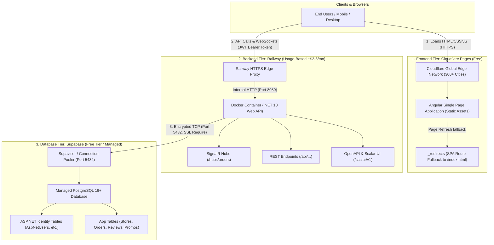
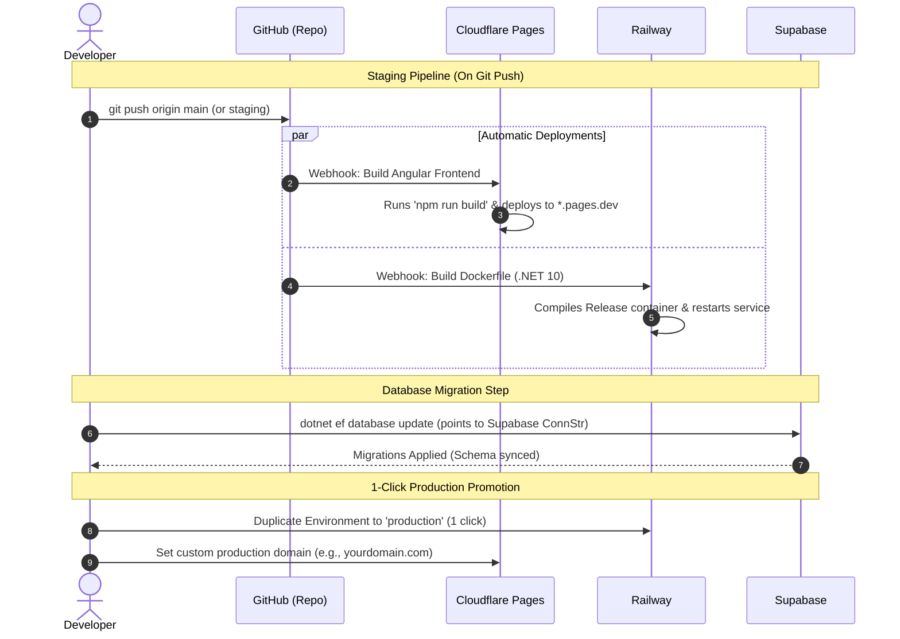

# Cloud Deployment Playbook: Cloudflare Pages + Railway + Supabase

A modern, highly cost-effective, and low-maintenance cloud architecture blueprint designed for full-stack applications (.NET Web API + Angular SPA + PostgreSQL).

---

## 1. High-Level Architecture Diagram



---

## 2. CI/CD & 1-Click Staging-to-Production Flow



---

## 3. Essential Project Files & Configurations

### A. Backend API (`Dockerfile`)
Placed at the root of the project for Railway auto-detection:

```dockerfile
# Build stage
FROM mcr.microsoft.com/dotnet/sdk:10.0 AS build
WORKDIR /src

# Copy csproj files first for optimal Docker layer caching
COPY ["src/FoodOrdering.Api/FoodOrdering.Api.csproj", "src/FoodOrdering.Api/"]
COPY ["src/FoodOrdering.Application/FoodOrdering.Application.csproj", "src/FoodOrdering.Application/"]
COPY ["src/FoodOrdering.Domain/FoodOrdering.Domain.csproj", "src/FoodOrdering.Domain/"]
COPY ["src/FoodOrdering.Infrastructure/FoodOrdering.Infrastructure.csproj", "src/FoodOrdering.Infrastructure/"]

RUN dotnet restore "src/FoodOrdering.Api/FoodOrdering.Api.csproj"

# Copy source and publish
COPY src/ src/
WORKDIR "/src/src/FoodOrdering.Api"
RUN dotnet publish "FoodOrdering.Api.csproj" -c Release -o /app/publish /p:UseAppHost=false

# Runtime stage
FROM mcr.microsoft.com/dotnet/aspnet:10.0 AS final
WORKDIR /app
COPY --from=build /app/publish .

# Standard cloud container port
ENV ASPNETCORE_HTTP_PORTS=8080
EXPOSE 8080

ENTRYPOINT ["dotnet", "FoodOrdering.Api.dll"]
```

### B. Ignore File (`.dockerignore`)
Placed in repo root alongside `Dockerfile`:

```dockerignore
**/.git
**/.vs
**/.vscode
**/bin
**/obj
**/node_modules
**/dist
**/.angular
*.user
*.suo
src/FoodOrdering.Web
```

### C. ASP.NET Core `Program.cs` Cloud Essentials

```csharp
using Microsoft.AspNetCore.HttpOverrides;

// 1. Trust Forwarded Headers from Cloudflare / Railway proxies
app.UseForwardedHeaders(new ForwardedHeadersOptions
{
    ForwardedHeaders = ForwardedHeaders.XForwardedFor | ForwardedHeaders.XForwardedProto
});

// 2. Dynamic CORS supporting Cloudflare Pages subdomains (*.pages.dev)
builder.Services.AddCors(options =>
{
    options.AddPolicy("Frontend", policy =>
    {
        policy.SetIsOriginAllowed(origin =>
        {
            if (string.IsNullOrWhiteSpace(origin)) return false;
            if (allowedOrigins.Contains(origin, StringComparer.OrdinalIgnoreCase)) return true;
            if (origin.EndsWith(".pages.dev", StringComparison.OrdinalIgnoreCase)) return true;
            if (origin.StartsWith("http://localhost", StringComparison.OrdinalIgnoreCase)) return true;
            return false;
        })
        .AllowAnyHeader()
        .AllowAnyMethod()
        .AllowCredentials();
    });
});

// 3. Expose API documentation in Staging as well as Development
if (app.Environment.IsDevelopment() || app.Environment.IsStaging())
{
    app.MapOpenApi();
    app.MapScalarApiReference();
}
```

### D. Cloudflare Pages SPA Routing (`src/FoodOrdering.Web/public/_redirects`)

```
/*    /index.html   200
```
> [!IMPORTANT]
> Because Angular is a Single Page Application, refreshing any route like `/stores/sushi` will return `404 Not Found` from static web servers unless this `_redirects` file routes fallback requests to `/index.html`.

### E. Frontend Environment (`src/environments/environment.ts`)

```typescript
export const environment = {
  production: true,
  apiUrl: 'https://foodordering-staging.up.railway.app' // MUST include https://
};
```

---

## 4. Railway Environment Variables Reference

In Railway $\rightarrow$ **Variables** tab, set:

| Variable Name | Example Value | Description |
| :--- | :--- | :--- |
| `ConnectionStrings__DefaultConnection` | `Host=aws-0-....pooler.supabase.com;Port=5432;...;SSL Mode=Require;Trust Server Certificate=true` | Supabase cloud PostgreSQL connection string |
| `Jwt__SecretKey` | `railway-staging-super-secret-key-at-least-32-chars!` | Cryptographic key for JWT tokens ($\ge 32$ chars) |
| `ASPNETCORE_ENVIRONMENT` | `Staging` | Activates staging behaviors and OpenAPI docs |
| `SeedAdmin__Email` | `admin@foodordering.local` | Platform admin initial email |
| `SeedAdmin__FullName` | `Platform Admin` | Admin display name |
| `SeedAdmin__Password` | `AdminPassword123` | Default admin password |

---

## 5. Reusable Step-by-Step Blueprint for Future Projects

When creating a new project from scratch, follow this exact 5-step checklist:

### Phase 1: Supabase (5 mins)
1. Go to [supabase.com](https://supabase.com) $\rightarrow$ "+ New project".
2. Pick project name, strong password, region closest to users.
3. Click **Connect** $\rightarrow$ Copy the URI connection string.
4. Run EF Core migrations from your local machine to initialize the database:
   ```powershell
   $env:ConnectionStrings__DefaultConnection="<paste-supabase-conn-str>"
   dotnet ef database update --project src/App.Infrastructure --startup-project src/App.Api
   ```

### Phase 2: Railway Backend (5 mins)
1. Ensure `Dockerfile` and `.dockerignore` are committed to GitHub.
2. Go to [railway.com](https://railway.com) $\rightarrow$ "New Project" $\rightarrow$ "Deploy from GitHub repo".
3. Under **Variables**, add:
   - `ConnectionStrings__DefaultConnection`
   - `Jwt__SecretKey`
   - `ASPNETCORE_ENVIRONMENT = Staging`
   - `SeedAdmin__Email`, `SeedAdmin__Password`
4. Under **Settings** $\rightarrow$ **Public Networking**, click **Generate Domain** $\rightarrow$ Copy the generated `https://...` link.

### Phase 3: Cloudflare Pages Frontend (5 mins)
1. In Angular `environment.ts`, set `apiUrl: 'https://your-railway-domain.up.railway.app'`.
2. Commit and push to GitHub.
3. Go to [dash.cloudflare.com](https://dash.cloudflare.com) $\rightarrow$ **Workers & Pages** $\rightarrow$ **Pages** tab $\rightarrow$ **Connect to Git**.
4. Configure build settings:
   - **Framework Preset**: `Angular`
   - **Root directory**: `src/AppName.Web`
   - **Build command**: `npm run build`
   - **Build output directory**: `dist/app-name/browser`
5. Click **Save and Deploy**.

---

## 6. Top 5 Gotchas to Remember

> [!WARNING]
> 1. **URL Scheme (`https://`)**: Always include `https://` in `environment.ts`. Writing bare domains (`my-api.up.railway.app`) causes browsers to treat them as relative URLs on the frontend host!
> 2. **SPA Client Routing**: Always add `_redirects` (`/* /index.html 200`) in `public/` so page refreshes don't 404 on Cloudflare.
> 3. **JWT Issuer & Audience**: Never leave `Jwt:Issuer` and `Jwt:Audience` blank in base `appsettings.json`, or the token validator will reject valid tokens with `401 Unauthorized`.
> 4. **Forwarded Headers**: Behind edge proxies (Railway/Render/Cloudflare), always add `app.UseForwardedHeaders(...)` before auth/CORS so ASP.NET Core recognizes HTTPS connections.
> 5. **Environment Variable Naming**: In ASP.NET Core, nested configuration paths use double underscores (`__`), e.g. `ConnectionStrings__DefaultConnection` and `SeedAdmin__Email`.
